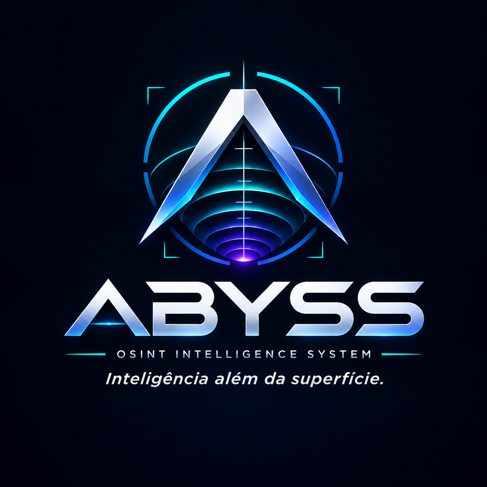

<p align="center">
  
</p>

# ABYSS

**Inteligência além da superfície.**

Ferramenta Python de OSINT comercial da Polypus IT Solutions. Organiza buscas sobre empresas e unidades, preserva fontes e exporta evidências para revisão humana. Não envia mensagens, propostas, candidaturas ou formulários.

**[Tutorial completo de instalação, configuração e atualização](docs/INSTALACAO.md)** — Windows, macOS e Linux.

## Versão 0.4.1

- **Instalador único por plataforma**, com Python e certificados incluídos, instalação por usuário e lançador. Não exige Python/Git separados.
- Configuração guiada do buscador, com chave Brave somente na sessão; atualização do executável por pacote oficial e SHA-256.

- Plano de pesquisa em nove dimensões: institucional, decisores, compras, tecnologia, projetos, pessoas, vagas, documentos e notícias.
- Localidade, aliases e múltiplos domínios oficiais informados pelo operador.
- Consultas focadas com alternativas `OR`, variações locais/corporativas e modo profundo com termos internacionais.
- Pesquisa por profissionais conhecidos, temas personalizados, arquivos de consultas e exclusão de domínios.
- Brave Search API, SearXNG e modo combinado, paginação e filtro temporal com orçamento total de chamadas.
- Modo manual sem rede e importação de referências JSON.
- Deduplicação por URL mantendo diferentes trechos e consultas de origem.
- JSON, CSV, relatório TXT, links de pesquisa e hashes SHA-256 dos arquivos exportados.
- Falhas registradas por provedor; preserva respostas parciais e continua com o outro provedor quando configurado.
- Checkpoint após cada chamada e retomada sem repetir páginas concluídas para o mesmo provedor/período.
- Sinais explicáveis de relação com o alvo para triagem, sem tratar coincidências de nome como vínculo confirmado.
- Interface leve no terminal: nova pesquisa, abrir pesquisa salva, paginação, filtros, detalhes e auditoria de consultas.
- Exportação PDF paginada e Excel `.xlsx` com abas Resumo, Fontes, Consultas e Plano.
- Aviso de novas releases estáveis e atualização pelo menu ou `--update`, preservando pesquisas e bloqueando mudanças locais.

Esta versão coleta resultados e trechos dos buscadores; **não faz leitura integral automática das páginas ou PDFs de origem, nem confirma cargos atuais**. Não extrai contatos de áreas autenticadas, não infere e-mails e não verifica autoridade de contratação. Referências importadas continuam identificadas como importação. Não depende de IA e não promete cobertura exaustiva.

## Instalar com um arquivo

Baixe o instalador para [Windows, macOS ou Linux na última release](https://github.com/mister-m-1337/abyss/releases/latest). O pacote inclui o programa e seu runtime; a chave Brave ou instância SearXNG deve ser fornecida pelo usuário. Veja o [passo a passo](docs/INSTALACAO.md#instalador-único--sem-python-ou-git-separados).

Executáveis ainda sem assinatura digital; o sistema operacional pode pedir autorização para abertura. Pacotes e certificados são gerados e testados pelo [workflow de instaladores](.github/workflows/installers.yml).

## Executar pelo código-fonte

Requer Python 3.10 ou superior. Usa somente a biblioteca padrão.

```bash
python3 abyss.py --ui
```

Executar `python3 abyss.py` em um terminal interativo também abre o menu. Use `Nova pesquisa` para escolher alvo, unidade, domínios, aliases e provedor. Ao concluir, a interface mostra as fontes e permite filtrar, consultar detalhes e exportar. No modo manual sem importação, há apenas um plano, sem resultados coletados. `Abrir pesquisa salva` recebe a pasta ou o caminho de `research.json`.

Os parâmetros de linha de comando continuam disponíveis:

```bash
python3 abyss.py --company "Empresa Exemplo" --location "Anápolis GO" --domain example.com
```

O modo padrão é `manual`: cria o plano e links de pesquisa, sem consultas de rede. A saída vai para uma pasta nova em `output/`. Pastas existentes não são sobrescritas.

Para receber atualizações pelo programa, instale com `git clone https://github.com/mister-m-1337/abyss.git` e execute dentro da pasta `abyss`. O [tutorial](docs/INSTALACAO.md) explica os requisitos e comandos de cada sistema operacional.

```bash
python3 abyss.py --company "Empresa Exemplo" --domain example.com \
  --import-json examples/reference.json --output output/demonstracao
```

O exemplo é fictício. Uma referência possui `title`, `url`, `snippet`, `category`, `query` e, opcionalmente, `published_date`. Consulte `examples/reference.json`.

## Exportar PDF e Excel

Pelo menu de resultados, escolha PDF, Excel ou ambos. Também é possível exportar sem abrir o menu:

```bash
python3 abyss.py --open output/demonstracao --export pdf xlsx
```

Para exportar ao final de uma pesquisa, acrescente `--export pdf xlsx` ao comando de busca. Cada exportação cria uma subpasta `export-*`, preservando arquivos anteriores, pesquisa JSON e seu manifesto. Um novo manifesto associa os relatórios ao hash do JSON original.

Excel usa o formato atual `.xlsx`, e não o binário legado `.xls`. Há cabeçalhos congelados, filtros e células de texto para impedir que trechos sejam interpretados como fórmulas. Células acima de 32.767 caracteres são truncadas apenas no Excel; o JSON preserva o conteúdo completo. O PDF A4 inclui evidências, URLs, origem, datas, erros e plano de pesquisa; sua fonte padrão suporta português/WinAnsi. Para outros alfabetos e símbolos, use Excel ou JSON, que preservam Unicode. Nenhum exportador exige instalação adicional.

## Busca automática

**Brave:** requer chave e plano contratado diretamente com o provedor. Não há chave incluída. As chamadas podem consumir sua cota ou gerar custos conforme o contrato. Defina `BRAVE_API_KEY` no ambiente, fora do repositório.

```bash
python3 abyss.py --company "Empresa Exemplo" --location "Anápolis GO" \
  --domain example.com --provider brave --max-queries 20 --count 10
```

**SearXNG:** requer uma instância existente com saída JSON habilitada. A aplicação não instala servidor nem escolhe instâncias públicas automaticamente.

```bash
python3 abyss.py --company "Empresa Exemplo" --provider searxng \
  --searxng-url http://localhost:8080 --max-queries 20
```

A busca usa requisições GET aos provedores configurados. O nome do alvo e os termos são enviados ao buscador, como em qualquer pesquisa; não são enviados ao alvo por mensagens ou formulários. Não há módulo de outreach, cadastro ou interação autenticada.

## Busca avançada e retomada

```bash
python3 abyss.py --company "Empresa Exemplo" --location "Anápolis GO" \
  --domain example.com --depth deep --person "Nome conhecido" \
  --keyword WinCC --provider brave --pages 3 --max-queries 20 \
  --max-requests 30 --freshness year --export pdf xlsx
```

O orçamento considera páginas e provedores; `--max-requests` limita chamadas novas. `--provider both` combina Brave/SearXNG se ambos estiverem configurados. Filtros temporais dependem da interpretação do buscador e não confirmam atualidade dos fatos.

```bash
python3 abyss.py --resume output/SUA-PESQUISA/checkpoint.json --max-queries 50
```

A retomada mantém o plano original, grava outra pasta e evita repetir páginas com sucesso no mesmo provedor/período. A credencial e o endereço SearXNG devem estar configurados novamente. Veja opções adicionais no [tutorial](docs/INSTALACAO.md).

## Atualizações

```bash
python3 abyss.py --check-update
python3 abyss.py --update
```

O menu avisa sobre releases novas (cache de 24h) e oferece atualização na opção 4. Instalações por executável baixam o pacote oficial de sua plataforma, verificam SHA-256 e mantêm versões anteriores. Instalações pelo código-fonte usam a tag estável oficial via Git na branch `main`, bloqueando alterações locais e histórico divergente. Pesquisas em `output/` são preservadas. Reabra pelo lançador após atualizar. Instalações de código-fonte por ZIP precisam migrar para clone Git ou instalador; consulte o tutorial. Defina `ABYSS_NO_UPDATE_CHECK=1` para desativar a checagem automática.

## Evidências e limites

`research.json` preserva consulta, provedor, horário de coleta, data de publicação informada pelo provedor, trecho e tipo de fonte. O horário de coleta não é a data do evento. Classificar um domínio como oficial depende da configuração do operador e não valida automaticamente sua propriedade.

Resultados de perfis podem estar desatualizados ou incluir publicações de terceiros. Não existe extração automática de organograma, aprovação de fatos, pontuação comercial ou conclusão de demanda. A validação da página original é uma etapa humana nesta versão.

`sources.csv` protege células que poderiam ser interpretadas como fórmulas por planilhas. Saídas, credenciais e dados de pesquisas não são versionados. Os hashes permitem verificar a integridade dos arquivos exportados, não autenticam o conteúdo do buscador.

## Verificação

```bash
python3 -m unittest discover -s tests -v
```

Testes de provedores usam respostas simuladas. Uma execução manual demonstra exportação e integridade; isso não comprova conectividade real de Brave/SearXNG.

## Desenvolvimento previsto

Leitura de páginas públicas e PDFs, rastreamento limitado a domínios selecionados, coleta de canais institucionais publicados, correlação de entidades, revisão de conflitos entre fontes e monitoramento periódico. Esses recursos ainda não estão implementados na versão 0.4.1.

## Uso e contribuições

Software proprietário, com licença de uso limitada descrita em [LICENSE](LICENSE). Não é software de código aberto. Contribuições externas não são aceitas; consulte [CONTRIBUTING.md](CONTRIBUTING.md).

Documentação dos provedores: [Brave Search](https://api-dashboard.search.brave.com/api-reference/web/search/get), [SearXNG](https://docs.searxng.org/dev/search_api.html).
